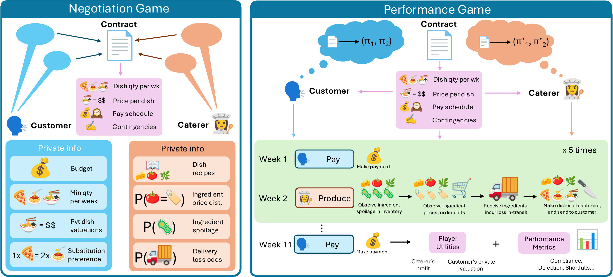

# ContractSim



ContractSim is the research code for studying LLM negotiation and contract
performance in stochastic contracting environments.

## Repository map

- `negotiation/`: runs the customer–supplier LLM negotiation protocol that produces contracts.
- `performance/`: executes agreed contracts with LLM and rational participants over the delivery weeks.
- `domain-robustness/`: reruns the fixed Environment 5 negotiation and performance games under Hotel Cleaning and AI Model Hosting terminology.
- `algorithms/rc-solver/`: exact JAX dynamic-programming solver for contract value under each contingency type.
- `algorithms/pareto/`: generates and merges F1/F2 Pareto frontiers over contract terms.
- `algorithms/synth-contracts/`: generates the synthetic performance-ready contract and policy suite.
- `analysis/`: parses, solves, and aggregates negotiation and performance run data into campaign statistics.
- `envs/`: the six resolved benchmark environments and their model-facing prompt contexts.
- `llm_utils/`: shared provider, agent, prompting, tracing, and process helpers used across the codebase.

## Setup

Python 3.12 is used for development.

```bash
python3 -m venv .venv
.venv/bin/python -m pip install -r requirements.txt
```

Live runs use `ANTHROPIC_API_KEY`, `OPENAI_API_KEY`, and either
`GEMINI_API_KEY` or `GOOGLE_API_KEY`, as applicable. File-backed credentials
can instead be stored under the directory selected by `KEYS_DIR`.

Use `--help` on an entry point before launching a large campaign.

## Citation

```bibtex
@misc{sajja2026evaluatingrationalcontractingnatural,
  title={Evaluating Rational Contracting in Natural Language},
  author={Bhavyesh Sajja and Max Kleiman-Weiner and Roger Zimmermann and Tan Zhi-Xuan},
  year={2026},
  eprint={2608.10475},
  archivePrefix={arXiv},
  primaryClass={cs.AI},
  url={https://arxiv.org/abs/2608.10475},
}
```
